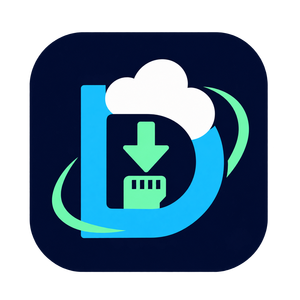

<p align="center"></p>

# Drive Browser

**Browse Google Drive and download files directly on your TrimUI Smart Pro.**

[Português](README.md) · [Downloads](https://github.com/kenfabioh/trimui-drive-browser/releases)

Drive Browser is a controller-operated file browser for the **original TrimUI
Smart Pro running CrossMix OS 1.3.0**. It uses rclone, an existing authenticated
configuration and a native SDL2 interface. No firmware changes or system package
installation are needed. The maintainer reports successful use on the target
console; automated tests also run on Linux and emulated ARM64 with local files.
The maintainer also reported successful pagination in 1.1.0 on their console.
The agent did not directly test hardware or benchmark network performance.
Other TrimUI models, OS versions and firmware revisions are not confirmed.

## Requirements

- Original TrimUI Smart Pro: Allwinner A133 Plus, Cortex-A53, Linux AArch64.
- CrossMix OS 1.3.0 and microSD mounted at `/mnt/SDCARD`, with sufficient free space.
- Working Wi-Fi, access to Google and correct device date/time.
- Existing `rclone.conf` with a working `type = drive` remote and refreshable token.

Initial card/configuration preparation may require a computer. Normal browsing
and downloads use only the console controls. There is **no OAuth login screen**;
valid existing credentials do not need to be authenticated again.

## Install or update

1. Download **`DriveBrowser-1.1.0-arm64.zip`** from Releases. GitHub's automatic
   **Source code** archive is not the ready-to-run application.
2. Extract the ZIP to the **root of your microSD**. You should have
   `Apps/DriveBrowser/launch.sh`, not `Apps/Apps/DriveBrowser/launch.sh`.
3. Place your private, authenticated configuration at
   `Apps/DriveBrowser/config/rclone.conf`. The included `.example` is only a
   template; it cannot log in. Locate your existing file with `rclone config file`
   on the computer where rclone already works. For a new configuration, follow
   [rclone's Google Drive guide](https://rclone.org/drive/), prefer read-only scope,
   and complete authorization once on that computer. Password-encrypted config
   files are not supported by this interface; use a securely stored decrypted copy.
4. Insert the card, connect Wi-Fi and open **Drive Browser** in Apps. Refresh
   the app list or restart the launcher if the entry/icon is cached.

To update, close the app and replace program files from the new ZIP. **Keep
`config/rclone.conf`, `config/settings.json`, `data/` and your downloads.**
The package contains no personal credentials. To uninstall, remove the app
folder after backing up your configuration; default downloads are stored outside it.

## Quick start and controls

Select a Drive remote, enter a folder, mark a file with **A**, then press **X**.
Choose a destination root and enter any existing subfolder with A. Press **X
again** to download into the displayed directory. B cancels. The completed file
is highlighted locally; B takes you back through the destination picker to the
original Drive file, preserving its position.

| Control | Action |
| --- | --- |
| D-pad / left stick | Navigate; hold to repeat |
| Left / right in lists | Move ten entries backward / forward |
| A | Open folder, mark file or choose keyboard key |
| B | Back / cancel listing or download |
| X | Choose destination / start download in displayed directory |
| Start | Menu, search, refresh, switch remote or exit |
| Select | Toggle focus between the file list and initial-letter strip |
| L / R (also L2 / R2) | Previous / next Drive page |

The app interface is currently in **Portuguese**. In the Start menu,
**Pesquisar nesta pasta e subpastas** searches filenames within the current
folder tree. Use the QWERTY keyboard, A to type and X/Buscar to search. Latin
case/accents are folded (`acao` matches `Áção.zip`). Select a result and download
normally. Search does not inspect file contents and can be cancelled with B.

Drive browsing loads up to **50 entries per page**, including folders. Use L/R
to switch pages. **Start → Itens por pagina**, left/right, then **A** saves the
quantity (10, 25, 50, 100, 200, 500 or 1,000). B discards unsaved changes. Saving
restarts browsing at page one when returning, without restarting the app. You
can also set any integer **1–1,000** using `page_size` in `config/settings.json`
while the app is closed. Existing settings default to 50. Refresh from Start
restarts a folder when its contents change.

The letter strip contains **Inicio** (first file), **0-9**, **A-Z** and `*`
(other initials). Move with the D-pad/stick; A confirms, Select returns to the
list and B leaves the strip. In Drive folders, initials apply to the current
page only. X cannot start a download while choosing a letter.

## Destination settings

The default is `/mnt/SDCARD/Downloads/DriveBrowser`. The app creates it as needed.
To allow other roots, copy `config/settings.example.json` to
`config/settings.json` and edit `allowed_roots`, for example:

```json
{
  "sd_root": "/mnt/SDCARD",
  "allowed_roots": ["/mnt/SDCARD/Downloads/DriveBrowser", "/mnt/SDCARD/Roms"],
  "page_size": 50,
  "download_buffer_mib": 16,
  "buttons": {"up":11,"down":12,"left":13,"right":14,"a":1,"b":0,"x":3,"start":6,"select":4}
}
```

Roots must be below the microSD mount; symlinks and unsafe paths are rejected.
Existing files are never overwritten. SDL button defaults follow the target
layout; they can be adjusted if your firmware maps controls differently.

## Privacy, limitations and troubleshooting

- The app only lists and reads remote files. It never uploads, moves or deletes
  Drive files. This does not reduce an existing token's permissions; prefer
  `drive.readonly`. Keep `rclone.conf` private and never attach it to an issue.
- One file downloads at a time. No folder downloads, queue or partial resume.
  Retry starts from zero. Native Google Docs are omitted; export them beforehand.
- Duplicate names within one Drive folder are rejected. Unicode names are
  preserved, although the bundled font cannot display every alphabet.
- FAT32 cannot store files of 4 GiB or larger. The app does not reformat cards.
- Search is limited to 5 minutes and 16 MiB of listing JSON. Use a smaller
  subfolder when these limits are reached. Other listings time out after 90s.
- Check Wi-Fi, device date/time, token validity, space and destination permissions
  when a transfer fails. If a file already exists, select a different destination
  or rename/remove it with a file manager.
- Handled cancellation/errors remove temporary files. Sudden power loss may
  leave `.drivebrowser-*.part`; remove app-owned leftovers with the app closed.
  On filesystems requiring the copy fallback, power loss while finalizing may
  leave an incomplete final filename; check size and remove before retrying.
- No bandwidth cap is imposed by the app. Downloads use one sequential stream
  with a 16 MiB buffer. A 32 MiB buffer may smooth stalls but does not guarantee
  better throughput; Wi-Fi, Internet/Google, CPU and microSD all affect speed.

If reporting a bug, include model, OS/firmware, app version, steps and a sanitized
error screenshot. Do not share tokens, client secrets, private filenames or config.

[Build/contribution guide](CONTRIBUTING.md) · [Validation](docs/VALIDATION.md) ·
[Release notes](docs/RELEASE-v1.1.0.md) · [Licenses](app/licenses/NOTICE.md)

GPL-3.0; bundled components retain their respective licenses. The approved icon
is a 300 × 300 RGBA PNG. Development/advanced documentation is primarily Portuguese.
