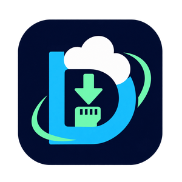
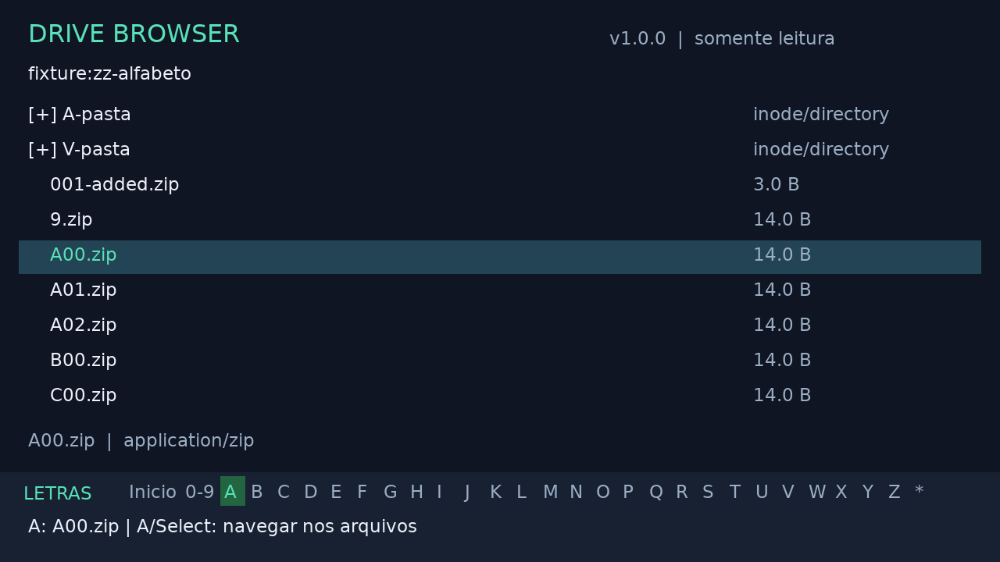
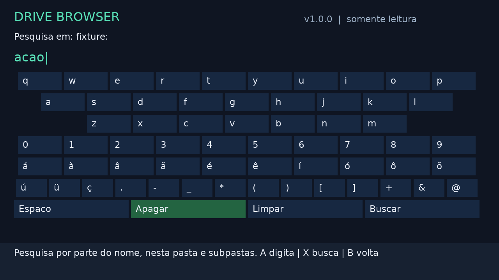

<p align="center"></p>

# Drive Browser

**Navegue pelo Google Drive e baixe arquivos diretamente no TrimUI Smart Pro.**

O Drive Browser é um gerenciador gráfico para o **TrimUI Smart Pro original**, com
**CrossMix OS 1.3.0**. Você escolhe uma pasta do Google Drive, encontra o arquivo
que deseja e o baixa para o microSD usando apenas os botões do console.

[English](README.en.md) · [Baixar em Releases](https://github.com/kenfabioh/trimui-drive-browser/releases) · [Guia completo](docs/GUIA.md) · [Ajuda](docs/AJUDA.md)

## O que ele faz

- Carrega seu `rclone.conf` existente e detecta os remotes configurados.
- Navega por páginas de 50 itens (configurável), com L/R para trocar de página.
- Mostra nomes, tipos e tamanhos de arquivos.
- Pesquisa por nome nas pastas e subpastas, com teclado QWERTY na tela.
- Salta pela inicial usando Select: **Início**, **0–9**, **A–Z** e outros caracteres.
- Baixa um arquivo por vez para uma pasta permitida do microSD.
- Mostra progresso, velocidade média, conclusão e erros; permite cancelar com B.
- Exibe o arquivo baixado na pasta local e preserva o cursor ao voltar ao Drive.
- Aceita direcional e analógico esquerdo, incluindo navegação ao segurar.

<details>
<summary>Ver a interface (demonstração com arquivos fictícios)</summary>




Capturas do teste automatizado SDL em Linux, não fotografias do console.
</details>

O acesso aos arquivos do Drive é **somente de leitura**: o aplicativo não envia,
move, modifica ou apaga arquivos remotos. Não é necessário instalar dependências
no sistema nem modificar o firmware.

## Requisitos

| Item | Necessário |
| --- | --- |
| Console | TrimUI Smart Pro **original**, Allwinner A133 Plus / ARM Cortex-A53 / Linux AArch64 |
| Sistema | CrossMix OS **1.3.0**, microSD montado em `/mnt/SDCARD` |
| Rede | Wi-Fi conectado, acesso ao Google Drive e data/hora corretas |
| Conta | Um `rclone.conf` autenticado, com pelo menos um remote `type = drive` |
| Armazenamento | Espaço livre para o aplicativo e os arquivos escolhidos |

O pacote inclui rclone ARM64 e bibliotecas da interface. A preparação inicial do
cartão e da configuração pode precisar de um computador; **durante o uso normal,
não é necessário computador ou celular**. A interface não realiza login OAuth.

O mantenedor relatou funcionamento no modelo alvo. Os testes automatizados usam
Linux e emulação ARM64 com arquivos locais. O mantenedor também confirmou o
funcionamento da paginação da versão 1.1.0 no seu aparelho. Não houve teste
direto do hardware pelo agente nem benchmark da rede. Isso não estabelece compatibilidade com
Smart Pro S, Brick, outros sistemas ou todas as revisões de firmware.
[Evidências e limites da validação](docs/VALIDATION.md).

## Instalação

1. Baixe **`DriveBrowser-1.1.0-arm64.zip`** na página de Releases. O arquivo
   **Source code** do GitHub é o código-fonte, não o aplicativo pronto.
2. Extraia o ZIP na **raiz do microSD**. A estrutura deve ficar assim:

   ```text
   Apps/DriveBrowser/
   ├── launch.sh
   ├── config.json
   ├── icon.png
   ├── bin/                 # interface e rclone
   ├── lib/                 # bibliotecas incluídas
   ├── res/                 # fonte e certificados
   ├── config/
   │   ├── rclone.conf.example
   │   ├── settings.example.json
   │   └── rclone.conf      # você adiciona este arquivo
   ├── docs/
   └── source/              # código e instruções de compilação
   ```

3. Copie **seu `rclone.conf` autenticado** para
   `Apps/DriveBrowser/config/rclone.conf`. Se ele já funciona no rclone, não é
   preciso refazer a autenticação. O exemplo incluído não contém um token válido.
   [Como localizar ou preparar a configuração](docs/AJUDA.md#configurar-o-google-drive).
4. Coloque o cartão no console, conecte o Wi-Fi e abra **Drive Browser** em Apps.
   Atualize a lista de aplicativos ou reinicie a interface se ele não aparecer.

Evite a estrutura incorreta `Apps/Apps/DriveBrowser`. Não copie bibliotecas para
o firmware. A pasta padrão de downloads é
**`/mnt/SDCARD/Downloads/DriveBrowser`**, criada quando necessário.

### Atualizar ou remover

Para atualizar, feche o app e extraia o novo ZIP na raiz do cartão, substituindo
os arquivos do programa. **Preserve `config/rclone.conf`, `config/settings.json`,
`data/` e seus downloads.** O ZIP não inclui configurações pessoais.

Para remover, feche o app e apague `Apps/DriveBrowser`; os downloads na pasta
padrão ficam fora dela. Guarde sua configuração antes de apagar a pasta do app.

## Como usar

1. Escolha o remote do Google Drive com **A** e entre nas pastas.
2. Marque o arquivo com **A**; **X** abre a escolha do destino. Sem uma marca,
   X usa o arquivo sob o cursor.
3. Escolha uma raiz permitida e use **A** para entrar em subpastas existentes.
4. Aperte **X novamente** para baixar na pasta exibida. **B** cancela a operação.
5. Ao concluir, o arquivo fica destacado no destino. Volte com **B** pelos níveis
   do seletor até o Drive; o cursor retorna ao arquivo baixado.

| Controle | Ação |
| --- | --- |
| Direcional / analógico esquerdo | Navegar; segurar repete o movimento |
| Esquerda / direita nas listas | Voltar / avançar dez itens |
| A | Abrir pasta, marcar arquivo ou escolher tecla |
| B | Voltar ou cancelar consulta/download |
| X | Escolher destino; no destino, iniciar o download |
| Start | Menu: atualizar, pesquisar, escolher destino, trocar remote ou sair |
| Select | Alternar entre arquivos e faixa de letras |
| L / R (também L2 / R2) | Página anterior / próxima no Drive |

**Pesquisar:** Start → **Pesquisar nesta pasta e subpastas**. Digite no teclado
QWERTY com direcional/analógico + A e use X ou Buscar. `acao` encontra `Áção.zip`.
A busca considera nomes, não o conteúdo dos arquivos. Nos resultados, selecione
com A e baixe com X.

**Paginação:** cada consulta carrega até **50 itens**, incluindo pastas. L volta
e R avança; páginas já abertas são reutilizadas. Para ajustar no console, use
**Start → Itens por página**, esquerda/direita e **A para salvar**. **B** descarta
um ajuste não salvo. As opções são 10, 25, 50, 100, 200, 500 e 1.000. A alteração
salva volta à primeira página ao retornar à lista e permanece após fechar o app.
Também é possível definir qualquer inteiro de **1 a 1.000** em `page_size` no
arquivo `config/settings.json`, com o app fechado. Configurações antigas usam 50.
Start → Atualizar reinicia a pasta se seu conteúdo mudou.

**Saltar pela inicial:** Select ativa a faixa. Escolha Início, 0–9, uma letra ou
`*` usando o direcional/analógico. A confirma; Select volta à lista; B sai da faixa
sem mudar de pasta. No Drive, o salto considera apenas a **página atual**.
Enquanto o foco está nas letras, X não baixa arquivos.

## Configuração, segurança e limites

- Para permitir outras pastas, copie `config/settings.example.json` para
  `config/settings.json` e ajuste `allowed_roots`. Os destinos devem ficar dentro
  do microSD; links simbólicos e caminhos inseguros são recusados.
- Arquivos existentes **não são sobrescritos**. Escolha outro destino ou remova/
  renomeie a cópia existente com seu gerenciador de arquivos.
- Trate `rclone.conf` como uma senha. Não o publique, envie em issues nem inclua
  em backups públicos. O rclone pode atualizar seu token nesse arquivo.
- O app só lê o Drive, mas não reduz permissões de um token já existente.
  Prefira uma configuração com escopo `drive.readonly`.
- Há uma transferência por vez, sem baixar pastas inteiras, fila ou retomada de
  parciais. Uma nova tentativa recomeça do zero. Documentos nativos Google são
  omitidos; exporte-os previamente se precisar baixá-los.
- Nomes duplicados na mesma pasta do Drive são recusados. Nomes com espaços e
  Unicode são preservados; alguns alfabetos podem não ter glifos na fonte.
- FAT32 não aceita arquivos de 4 GiB ou maiores. O app não converte o cartão.
- Pesquisa: limite de 5 minutos e 16 MiB de listagem; em árvores grandes,
  pesquise dentro de uma subpasta. B cancela.
- A velocidade depende de Wi-Fi, Internet/Google, CPU e microSD. O buffer padrão
  é 16 MiB; aumentar para 32 MiB não garante ganho. [Detalhes e recuperação de parciais](docs/GUIA.md).

## Ajuda e desenvolvimento

- [Configurar o Drive, solucionar erros e pedir ajuda](docs/AJUDA.md)
- [Guia detalhado: destinos, controles, desempenho e recuperação](docs/GUIA.md)
- [Compilar, testar e contribuir](CONTRIBUTING.md)
- [Notas da versão 1.1.0](docs/RELEASE-v1.1.0.md) · [Histórico](CHANGELOG.md)
- [Arquitetura e pesquisa de compatibilidade](docs/ARCHITECTURE.md)

Licença **GPL-3.0**. Bibliotecas, fontes, rclone e certificados têm suas próprias
licenças, incluídas em [app/licenses/NOTICE.md](app/licenses/NOTICE.md) e em
`licenses/` no pacote. O ícone escolhido é **D na nuvem**, PNG RGBA 300 × 300.
